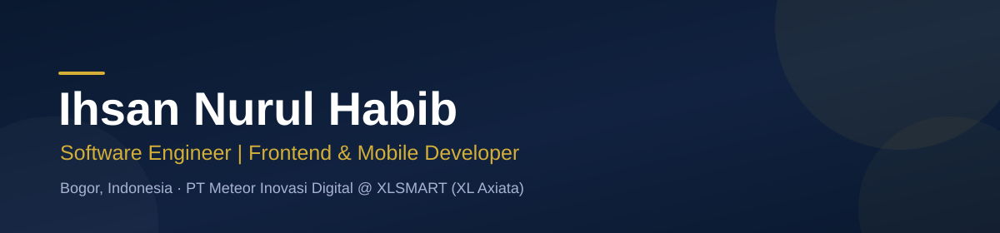
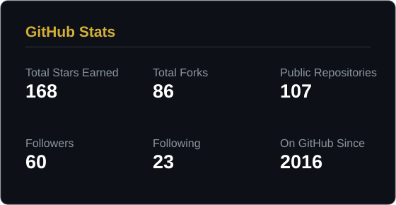
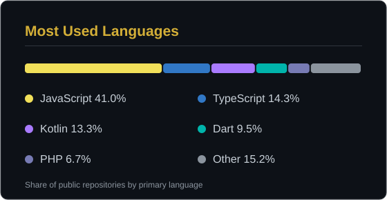
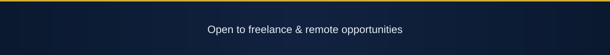

  

  

---

## About Me

Software Engineer specializing in frontend and mobile development, based in Bogor, Indonesia. Currently working at **PT Meteor Inovasi Digital**, placed at **PT XLSMART Telecom Sejahtera Tbk (XL Axiata)**, building and maintaining large-scale consumer web platforms for the AXIS brand.

- Currently building: AXIS Store and the AXIS x Wondr (BNI) microsite integration at XL Axiata
- Personal projects: **Solearn AI Center** (AI learning platform, React Native + Node.js), Hire Me Simulator, and AI Quiz & Battle Arena
- Experienced with production delivery end to end: architecture, CI/CD, app signing, analytics, and payment integrations
- Open to freelance and remote opportunities in frontend & mobile engineering

## Tech Stack

**Languages & Frameworks**

  

**Tools & Platforms**

  

## Featured Projects

| Project | Description | Stars |
| --- | --- | --- |
| [Al-Quran Mobile React Native](https://github.com/ihsaninh/Al-Quran-mobile-react-native) | Al-Quran mobile app built with React Native and Redux |  |
| [Flutter TMDB Movie](https://github.com/ihsaninh/flutter-tmdbmovie-bloc-cubit) | Movie discovery app in Flutter with BLoC/Cubit state management |  |
| [Crossword React Native](https://github.com/ihsaninh/crossword-react-native) | Crossword game built with React Native |  |
| [AWS Face Liveness Next.js](https://github.com/ihsaninh/aws-rekognition-amplify-face-liveness-nextjs) | Reference implementation of AWS Amplify Face Liveness with Rekognition in Next.js |  |

## GitHub Stats

  
  

  

## Blog & Writing

Apart from coding, I write about software development on my blog: **[ihsaninh.dev/blog](https://ihsaninh.dev/blog)**

## Connect With Me

  
  
  
  
  

